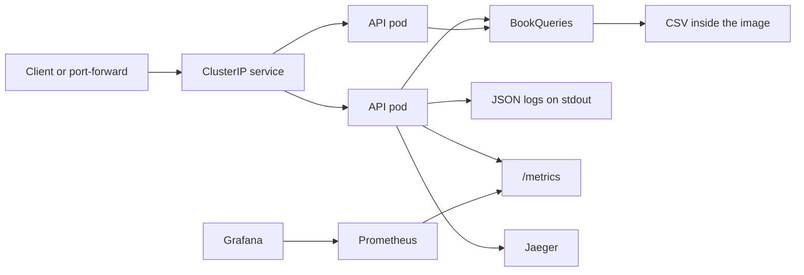
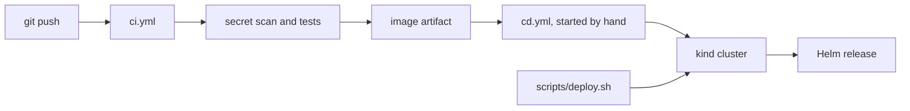

# Architecture

BestSellers is one process. Kubernetes keeps two copies of that process running. Helm is the source of the pod spec. CI builds the image, and CD is a separate manual workflow.

## Runtime

A request hits the Service, then one of the two pods. `ApiServer` logs the request, records latency, and starts a trace. `BookQueries` reads the catalog that was loaded at startup. The response does not wait on Jaeger. Prometheus scrapes `/metrics` every five seconds, and Grafana reads Prometheus.

## Delivery

The image tag is the git commit. kind loads that image. There is no registry push.
